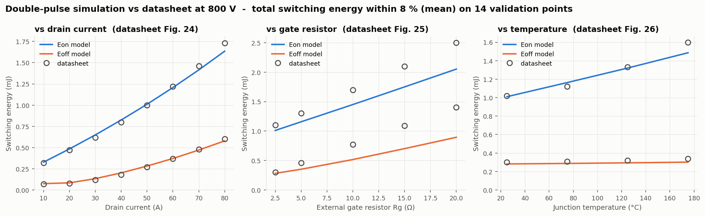
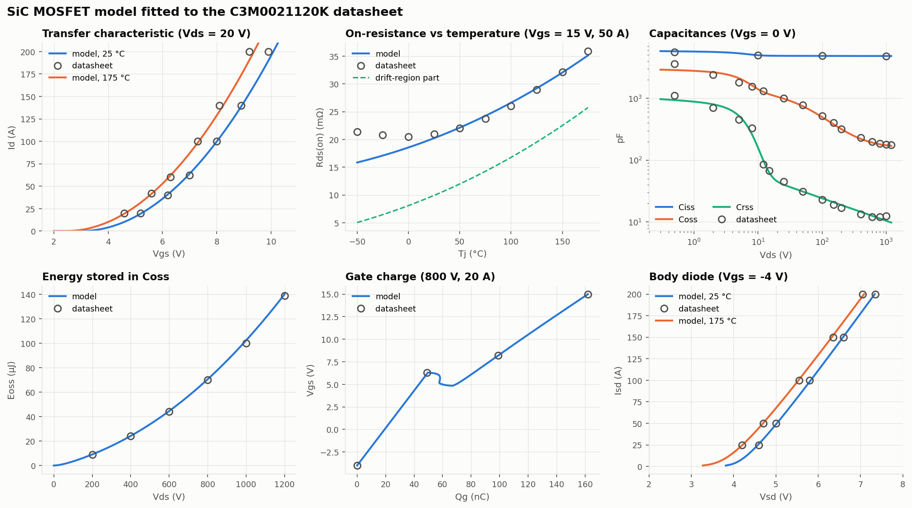
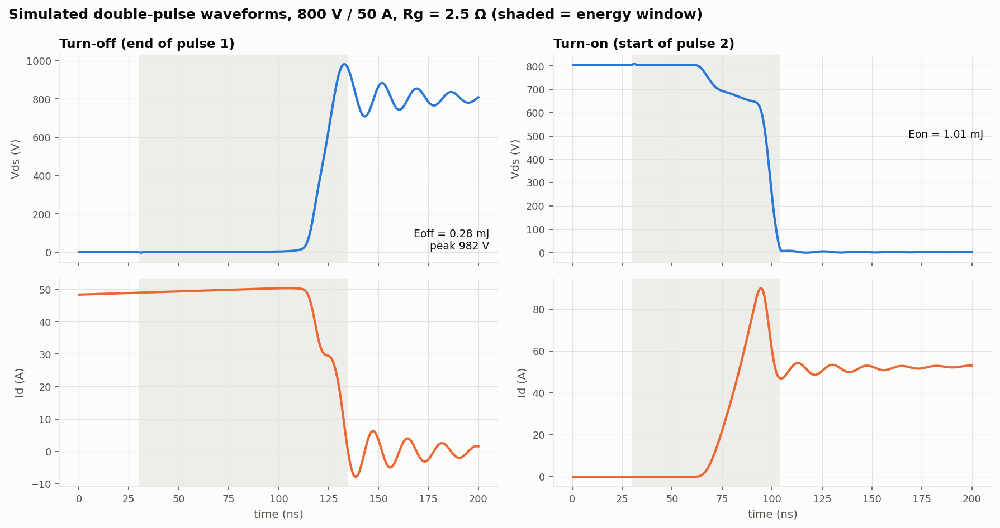
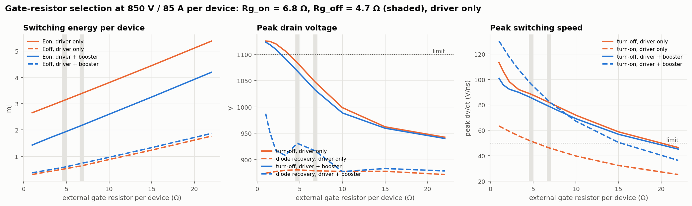
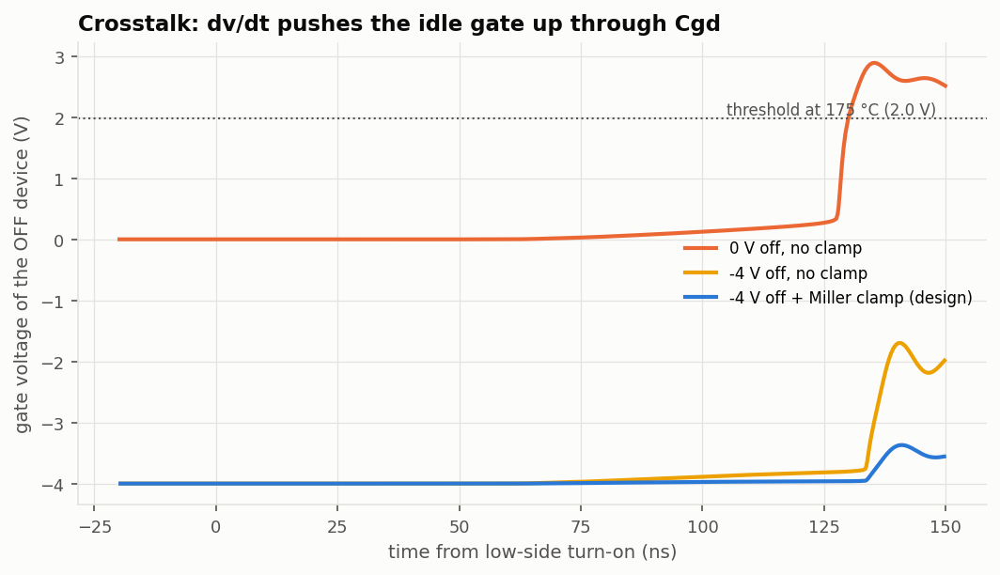
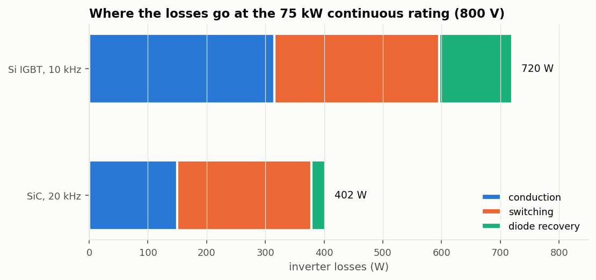
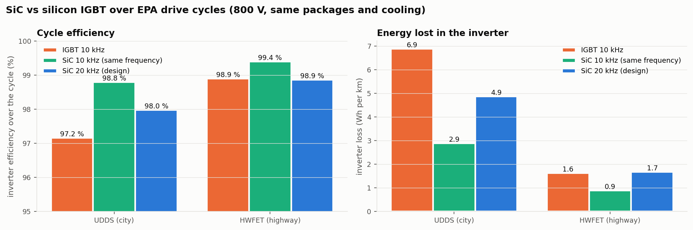
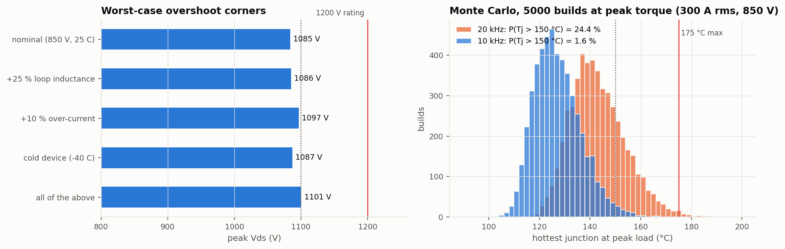
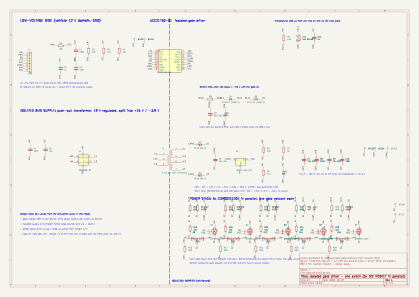
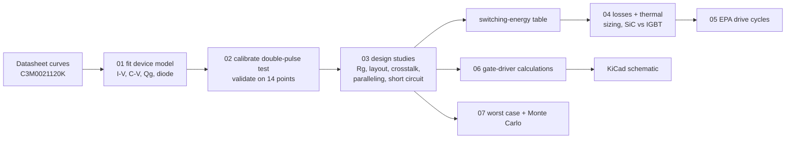

# 800 V SiC Traction Inverter: Power Stage and Gate Driver Design

A simulation-driven design of one switch of an 800 V electric-vehicle traction inverter,
built from datasheets up with free tools (Python, ngspice, KiCad):

1. a **SPICE model of a 1200 V silicon-carbide MOSFET** fitted to the Wolfspeed C3M0021120K datasheet,
2. a **double-pulse test bench** calibrated against the datasheet's switching energies and validated on 14 points it never saw,
3. **design studies** that set the gate resistors, the layout-inductance budget, the negative gate bias and Miller clamp, parallel-device current sharing and short-circuit (DESAT) protection,
4. an **electro-thermal loss model** that sizes the number of devices and compares SiC with a silicon IGBT over EPA drive cycles,
5. a **worst-case analysis and 5,000-build Monte Carlo**, and
6. a **KiCad schematic** of the isolated gate driver (TI UCC21750-Q1) and five paralleled SiC MOSFETs, with every value taken from the simulations.



## Results at a glance

| | Result |
|---|---|
| Device model vs datasheet | R<sub>DS(on)</sub> within 2 % over 25–175 °C; gate charge 162 nC (datasheet 162); C<sub>oss</sub> energy within 1 %; body-diode V<sub>SD</sub> within 0.02 V |
| Independent check | fitted thresholds 2.53 V / 1.98 V vs datasheet 2.5 V / 2.0 V (never used in the fit) |
| Switching energy, 14 validation points | E<sub>on</sub>+E<sub>off</sub> mean error 3.4 % vs current, 1.8 % vs temperature; under-predicts the gate-resistor effect above 5 Ω (up to 24 %) |
| Design | 5 × C3M0021120K per switch (30 per inverter), R<sub>g,on</sub> 6.8 Ω, R<sub>g,off</sub> 4.7 Ω, UCC21750-Q1 direct drive, +15 / −4 V, active Miller clamp |
| Worst-case turn-off overshoot | 1101 V (850 V bus, +25 % loop inductance, +10 % current, −40 °C): below the 1200 V rating |
| Short circuit | DESAT trips in 0.72 µs (typ) / 0.96 µs (worst); fault cleared in 1.35 / 1.97 µs, under SiC's ~2 µs withstand time |
| Loss at 75 kW (800 V) | SiC at 20 kHz: **402 W (99.47 %)** vs Si IGBT at 10 kHz: 720 W (99.05 %) |
| EPA city cycle (UDDS) | inverter energy loss **−58 %** vs IGBT at the same 10 kHz (−29 % with SiC at 20 kHz) |
| EPA highway cycle (HWFET) | **−45 %** at the same 10 kHz; at 20 kHz SiC and IGBT tie |
| Thermal (Monte Carlo, peak torque) | at 20 kHz 24 % of builds exceed 150 °C, so peak torque runs at 10 kHz: 1.6 % above 150 °C, none above the 175 °C limit |

## What the design studies decided

Every value comes from a simulation sweep, not a rule of thumb.

| Question | What the simulation showed | Decision |
|---|---|---|
| How many MOSFETs per switch? | 4 per switch reach 182 °C at peak current; 5 reach 134 °C ([fig](figures/04a_thermal_sizing.png)) | **5** |
| Gate resistors? | small R<sub>g,off</sub> gives fast, low-loss turn-off but overshoots past 1100 V; turn-on speed is capped by a 50 V/ns dv/dt budget ([fig](figures/03a_gate_resistor.png)) | **6.8 Ω on, 4.7 Ω off** |
| Add a gate-driver booster? | when dv/dt limits the turn-on speed, a stronger driver can't help: the booster version lost (4.7 vs 3.9 mJ per device) | **UCC21750-Q1 alone** |
| Layout inductance? | with only an 8 nH busbar, staying under the overshoot limit needed a 22 Ω turn-off resistor and about 3× the turn-off loss; local HF capacitors fix that if the loop from them to the switches is ≤ 2.5 nH ([fig](figures/03b_loop_inductance.png)) | **1 µF HF caps, 2 nH loop** |
| Negative gate voltage? | with 0 V off-bias the idle device's gate is kicked to +2.9 V, above its 2.0 V threshold when hot (false turn-on); −4 V plus a Miller clamp holds it at −3.4 V ([fig](figures/03d_crosstalk.png)) | **−4 V + Miller clamp** |
| Device mismatch in parallel? | ±0.3 V threshold spread gives the worst device 10 % more switching energy and 6 % more peak current ([fig](figures/03e_paralleling.png)) | individual gate resistors, carried into the Monte Carlo |
| DESAT blanking capacitor? | 22 pF cleared a short in 2.24 µs worst case; 10 pF in 1.97 µs ([fig](figures/03f_short_circuit.png)) | **10 pF** |
| Switching frequency at peak torque? | 20 kHz: 24 % of builds exceed 150 °C; 10 kHz: 1.6 % ([fig](figures/07_worst_case.png)) | **20 kHz cruising, 10 kHz at peak torque** |

## Selected figures

| | |
|---|---|
|  Device model vs datasheet |  Simulated double-pulse waveforms |
|  Gate-resistor selection |  Crosstalk and the Miller clamp |
|  Where the losses go at 75 kW |  SiC vs IGBT over EPA cycles |
|  Worst case + Monte Carlo |  Gate-driver schematic (KiCad) |

## How it works



The full write-up, with the equations and reasoning for each step, is in **[docs/design-report.md](docs/design-report.md)**.

## Specification

| | |
|---|---|
| DC link | 800 V nominal (550–850 V) |
| Power | 150 kW peak (10 s), 75 kW continuous |
| Phase current | 300 A<sub>rms</sub> peak, 160 A<sub>rms</sub> continuous |
| Coolant | 65 °C water-glycol |
| Limits I set | T<sub>j</sub> ≤ 150 °C, V<sub>DS</sub> ≤ 1100 V at the worst corner, turn-on dv/dt ≤ 50 V/ns |

## Reproduce

Everything is free. Install [ngspice](https://ngspice.sourceforge.io) (set `NGSPICE` to `ngspice_con.exe` if it isn't on the PATH) and Python 3.10+:

```bash
pip install -r requirements.txt
python scripts/run_all.py          # about 30 minutes; the double-pulse simulations dominate
python hardware/gen_gate_driver.py # regenerates the KiCad schematic from the results
```

| Script | Does |
|---|---|
| `01_fit_device.py` | fits the SiC MOSFET model to the datasheet's static curves |
| `02_calibrate_dpt.py` | calibrates the double-pulse bench, validates on 14 datasheet points |
| `03_switching_design.py` | gate resistors, layout budget, energy table, crosstalk, paralleling, short circuit |
| `04_losses_thermal.py` | thermal network, device count, efficiency, SiC vs IGBT |
| `05_drive_cycle.py` | EPA UDDS and HWFET cycles |
| `06_gate_driver.py` | gate-drive power, peak currents, DESAT, CMTI, isolation |
| `07_worst_case.py` | worst-case corners and Monte Carlo |

## Limitations

- The model is calibrated to **datasheet** measurements, not to my own bench data. Its fitted fixture values (driver resistance, loop inductance) absorb whatever the datasheet's test setup was.
- Switching **delay times** come out 30–50 % longer than the datasheet's, even though the energies match. The model also under-predicts the effect of very large gate resistors.
- The short-circuit simulation is **isothermal**, so its fault current is an upper bound. A real die heats up and its current falls.
- The thermal stack puts Foster networks in series, a common first-pass simplification that is exact only in steady state.
- The vehicle and motor models are deliberately simple: a representative sedan, and a permanent-magnet motor below base speed.
- There is **no PCB layout** yet. The loop-inductance budget (≤ 2.5 nH) is the requirement it must meet.

## Next steps

PCB layout of the gate-driver board in KiCad against the 2.5 nH loop budget; a double-pulse test on real hardware; porting the bench to LTspice with the manufacturer's model for a cross-check.

## Data sources

Wolfspeed C3M0021120K datasheet (Rev. 4, 2025); Infineon IKY75N120CH7 datasheet (Rev. 1.20); TI UCC21750-Q1 datasheet (SLUSDH9D); EPA dynamometer drive schedules (UDDS, HWFET). Datasheet curves were digitized by hand. The values are in `data/`, with figure references.

## License

MIT
